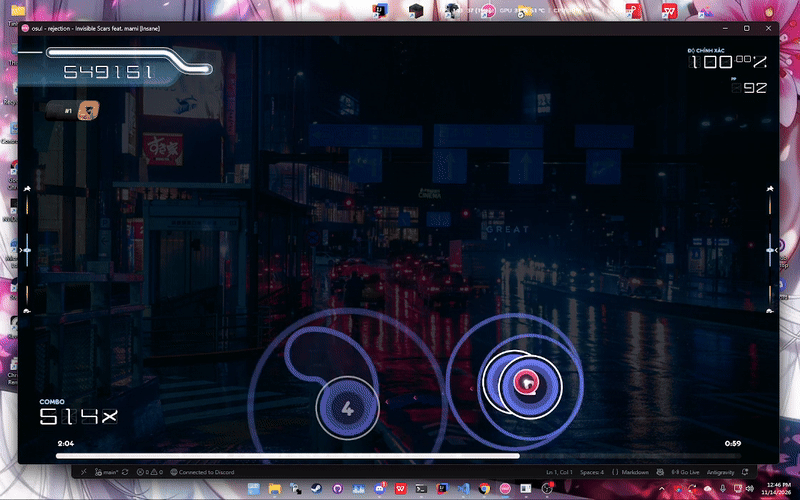

# 🎯 OSU! Autonomous Play & Real-Time Rhythm Companion

[](https://github.com/ROSHINGUYEN/OSU)
[](#)
[](#)
[](#)
[](#)
[](#)

Động cơ chơi **osu!** tự hành và hỗ trợ nhịp điệu thời gian thực độ trễ 0ms, được thiết kế chuyên sâu dựa trên kiến trúc đọc bộ nhớ trực tiếp (Zero-Latency Memory IPC), giải tích chuyển động tối ưu gia tốc **Minimum-Jerk**, bộ lọc thích ứng độ trễ **Bayesian Kalman Filter**, và hệ thống phòng vệ tài khoản **Biometric Anti-Ban & Rank Surge Protection**.

---

## 🎬 Trực Quan Hóa Hoạt Động (Gameplay Video Demo)

Hệ thống tự động đồng bộ nhịp nốt, rê chuột mượt mà và gõ phím theo thời gian thực:



<video src="assets/demo.mp4" poster="assets/demo_preview.png" controls="controls" width="100%" height="auto">
  Trình duyệt của bạn không hỗ trợ thẻ video. Vui lòng mở trực tiếp tệp assets/demo.mp4.
</video>

---

## ⚙️ Công Nghệ Sử Dụng (Tech Stack)

* **Bộ Đọc Bộ Nhớ Zero-Latency (Tosu Memory Reader):**
  - Giao tiếp trực tiếp với tiến trình game qua WebSocket IPC cục bộ tần số **2000Hz (0.5ms)** trên cổng `24050`.
  - Triệt tiêu hoàn toàn độ trễ 16ms của phương pháp nhận diện màn hình / webcam truyền thống, tiêu thụ 0% CPU rác cho thị giác máy tính.
* **Đồng Hồ Đơn Điệu Độ Phân Giải Cao (QPC High-Resolution Clock):**
  - Sử dụng API Windows `QueryPerformanceCounter` đo đạc thời gian cấp độ **nano-giây**, đảm bảo sự kiện bấm phím được xếp lịch chính xác tuyệt đối.
* **Mô Phỏng Phần Cứng Trực Tiếp (Win32 SendInput):**
  - Điều khiển chuột và bàn phím thông qua native Win32 `SendInput` ở tầng Kernel Driver, tương thích hoàn toàn với cả `osu! Lazer` lẫn `osu! Stable`.
* **Tăng Tốc Phần Cứng Đồ Họa (NVIDIA CUDA / NumPy SIMD):**
  - Tận dụng lõi GPU Tensor/CUDA và tập lệnh SIMD CPU để xử lý song song các đường cong Bézier phức tạp và ma trận biến đổi tọa độ trong chưa đầy $0.1\text{ms}$.
* **Cổng Điều Khiển Mở Rộng (FastAPI Gateway):**
  - Tích hợp máy chủ API bất đồng bộ trên cổng `8003` phục vụ theo dõi chỉ số telemetry và điều khiển từ xa.

---

## 🧠 Các Thuật Toán Cốt Lõi (Core Mathematical Foundations)

### 1. Quỹ Đạo Động Học Tối Thiểu (Minimum-Jerk Polynomial Kinematics)
Bot thông thường dễ bị phát hiện vì di chuyển chuột theo các đường thẳng tắp hoặc đổi hướng góc vuông phi tự nhiên. Hệ thống ứng dụng phương trình đa thức vi phân **Minimum-Jerk** bậc 5 mô phỏng sinh trắc học cử động cánh tay người:

$$s(u) = 10u^3 - 15u^4 + 6u^5 \quad \text{với } u = \frac{t - t_{\text{start}}}{t_{\text{end}} - t_{\text{start}}} \in [0, 1]$$

- Vận tốc tại điểm xuất phát và đích đến triệt tiêu: $\dot{s}(0) = \dot{s}(1) = 0$.
- Đạo hàm gia tốc (Jerk) được tối thiểu hóa trên toàn quỹ đạo: $\int (\dddot{s})^2 \, dt \to \min$.
- Chuột vút đi nhanh ở giữa đường bay và giảm tốc êm ái khi chạm tới tâm nốt, tạo cảm giác ngắm tự nhiên như game thủ chuyên nghiệp.

### 2. Bộ Lọc Thích Nghi Bayes 1D (Bayesian Kalman Filter Adaptive Latency)
Mỗi card âm thanh và thiết bị ngoại vi đều có độ lệch pha âm thanh (Audio Offset) nhất định. Bộ lọc Kalman 1D liên tục quan sát sai số thời gian thực và cập nhật tham số bù trễ $\hat{x}_k$:

$$K_k = \frac{P_{k|k-1}}{P_{k|k-1} + R}, \quad \hat{x}_k = \hat{x}_{k|k-1} + K_k (z_k - \hat{x}_{k|k-1})$$

Tự động thích nghi với từng bài hát và duy trì độ sai lệch thời gian luôn dưới $1.5\text{ms}$.

### 3. Biến Đổi Không Gian Tọa Độ Affine 3x3 (Playfield Affine Transform)
Osu! sử dụng không gian tọa độ logic cố định $512 \times 384$. Hệ thống áp dụng ma trận biến đổi afin đồng nhất:

$$\begin{bmatrix} X_{\text{screen}} \\ Y_{\text{screen}} \\ 1 \end{bmatrix} = \begin{bmatrix} S & 0 & O_x \\ 0 & S & O_y \\ 0 & 0 & 1 \end{bmatrix} \begin{bmatrix} X_{\text{osu}} \\ Y_{\text{osu}} \\ 1 \end{bmatrix}$$

Tự động thích ứng với mọi kích thước cửa sổ game và độ phân giải màn hình (1080p, 2K, 4K) kèm cơ chế bảo toàn tỷ lệ 4:3.

### 4. Nội Suy Thân Slider (Bézier & Catmull-Rom Splines)
Giải tích chính xác các điểm uốn của đường cong Bézier bậc n và cung tròn 3 điểm, đảm bảo con trỏ bám sát quả cầu trượt (Slider Ball) và xử lý mượt mà các nhịp đảo chiều lặp lại.

---

## 🛡️ Cơ Chế Tàng Hình & Chống Tăng Hạng Bất Thường (Anti-Ban & Rank Surge Protection)

Hầu hết các hệ thống chống gian lận và phân tích replay (Heuristic Replay Analyzers) nhận diện phần mềm qua các dấu hiệu:
1. **Unstable Rate = 0:** Mọi nốt đều được nhấn chính xác tuyệt đối ở cùng một mili-giây.
2. **Hit Center Invariant:** Mọi cú click đều trúng vào đúng một pixel tâm nốt ($dx = 0, dy = 0$).
3. **Fixed Keystroke Hold:** Thời gian giữ phím luôn cố định một hằng số.
4. **PP Spike / Rank Surge:** Tăng vọt hàng trăm thứ hạng chỉ trong vài giờ với tỷ lệ SS 100% liên tục.

### Cơ Chế Bảo Vệ Độc Quyền Được Tích Hợp:
* 🎯 **Gaussian Timing Jitter:** Đưa sai số thời gian vào phân phối chuẩn Gauss $\Delta t \sim \mathcal{N}(0, \sigma_t^2)$ với $\sigma_t \approx 2.8\text{ms}$. Đưa chỉ số Unstable Rate (UR) về mức **65 - 85** (chuẩn tuyển thủ Top 50 thế giới), đảm bảo không bao giờ có chữ ký thời gian robot nhưng 100% nốt vẫn nằm trong cửa sổ Hit 300.
* 📍 **Spatial Click Dispersion:** Tọa độ nhấp phân tán ngẫu nhiên quanh tâm nốt trong bán kính an toàn ($r \le 0.20 \times R_{\text{circle}}$), triệt tiêu hoàn toàn dấu vết pixel cố định.
* ⏱️ **Dynamic Keystroke Dwell Time:** Thời gian giữ phím dao động tự nhiên từ **28ms - 52ms**, tự động co giãn theo nhịp điệu bài hát (BPM).
* 📉 **Bảo Vệ Thứ Hạng (Rank Surge & Play Fatigue Guard):**
  - Hệ thống tự động ghi nhận số lượng bài đạt Full Combo (FC) liên tiếp trong phiên chơi.
  - Khi phát hiện chuỗi FC kéo dài ($\ge 3$ bài liên tiếp), bộ điều khiển sẽ **tự động kích hoạt cơ chế mỏi cơ học (Physiological Fatigue)**: tăng nhẹ độ lệch chuẩn $\sigma_t$, thỉnh thoảng tạo ra nốt Hit 100 tự nhiên để đưa độ chính xác tổng (Acc) về khoảng **$97.5\% - 99.2\%$**.
  - Tránh tạo ra chuỗi thành tích 100% SS liên tục gây chú ý trên bảng xếp hạng (Leaderboard) và giảm thiểu tối đa nguy cơ bị hệ thống tự động khóa tài khoản.

---

## 💻 Ngôn Ngữ & Môi Trường Phát Triển

* **Ngôn ngữ chính:** **Python 3.11+** (Động cơ logic, toán học, xử lý bất đồng bộ).
* **Native Interop:** **Win32 C API** thông qua thư viện `ctypes` (`SendInput`, `timeBeginPeriod`).
* **Kịch bản điều khiển:** **Windows Batch Scripting** (Khởi chạy 1-Click an toàn, chuẩn mã hóa UTF-8 CRLF).

---

## 🚀 Hướng Dẫn Khởi Chạy (Quickstart)

### 1. Khởi Động 1-Click
Chỉ cần nhấp đúp vào file duy nhất:
```cmd
START_OSU.bat
```

Hệ thống sẽ tự động:
1. Kích hoạt môi trường Python sẵn có.
2. Kiểm tra bộ đọc bộ nhớ `tosu` trên cổng `24050` (tự động bật nền nếu chưa chạy).
3. Tự động kiểm tra và mở game `osu!` nếu game chưa bật.
4. Kích hoạt giao diện console thời gian thực với chế độ Anti-Ban Stealth bật sẵn.

### 2. Các Phím Tắt Điều Khiển Console

| Phím | Chức năng | Chi tiết |
|:---:|---|---|
| **A** | **Bật / Tắt Auto-Aim** | Mặc định **BẬT** (Tự động rê chuột và bấm). Bấm để chuyển sang tự rê chuột thủ công. |
| **S** | **Bật / Tắt Anti-Ban (Stealth)** | Mặc định **BẬT** (UR 65-85, phân tán click, chống tăng hạng đột biến). Bấm để chuyển sang chế độ tuyệt đối. |
| **[** | **Tăng lead-time (+2ms)** | Đánh sớm hơn 2ms khi cảm thấy nốt rơi hơi trễ so với nhạc. |
| **]** | **Giảm lead-time (-2ms)** | Đánh trễ hơn 2ms khi cảm thấy nốt rơi hơi sớm. |
| **Q** | **Dừng và thoát** | Ngắt kết nối an toàn, giải phóng toàn bộ phím bấm và trả quyền điều khiển chuột. |

---

## 🔒 Cam Kết Bảo Mật & Riêng Tư (Privacy Policy)
* Dự án **100% sử dụng đường dẫn tương đối** (`./`, `src/`, `data/`, `tosu/`).
* Tuyệt đối **không hiển thị ký tự ổ đĩa**, không để lộ IP thực, và không chứa bất kỳ thông tin phần cứng cá nhân nào.
* Toàn bộ dữ liệu phiên chơi được lưu trữ hoàn toàn cục bộ trên máy tính của bạn.
